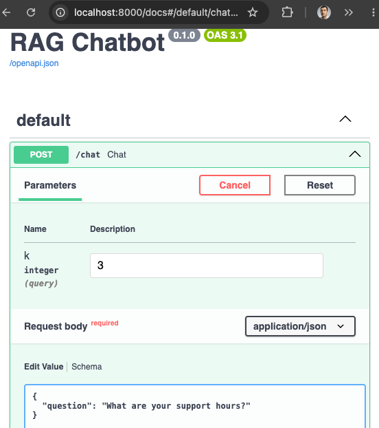
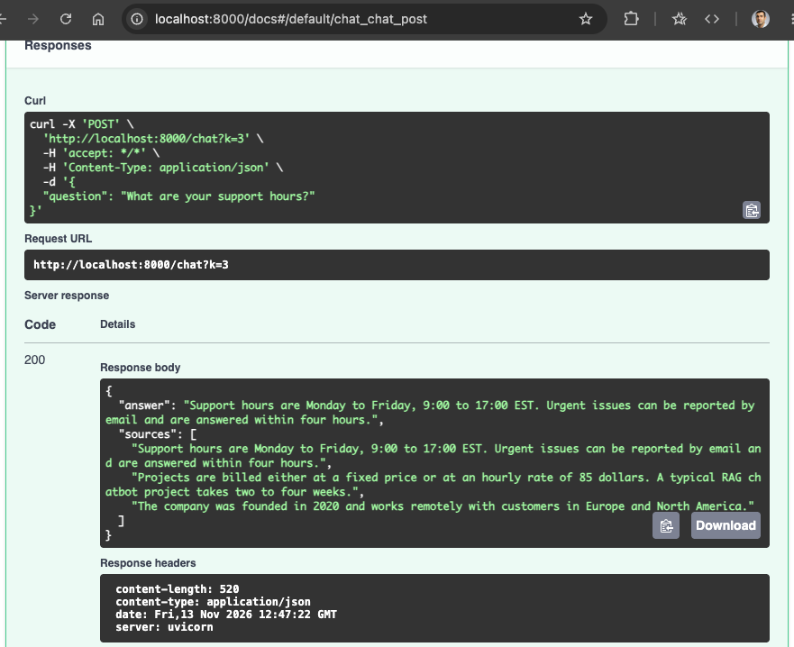

# RAG Chatbot (FastAPI + FAISS + Claude)

A tiny Retrieval-Augmented Generation chatbot in ~45 lines of Python. It answers questions using only the documents in `docs/`.

## How it works
1. **Load and chunk**: `docs/*.txt` are split into paragraphs.
2. **Embed and index**: chunks are embedded locally (`all-MiniLM-L6-v2`) and stored in a FAISS index.
3. **Retrieve**: the question is embedded and the top-3 most similar chunks are fetched.
4. **Generate**: Claude answers from those chunks only, and says "I don't know" otherwise (reduces hallucination).

## Run
```bash
pip install -r requirements.txt
cp .env.example .env   # then put your Anthropic API key in .env
uvicorn app:app --reload
```

Open http://localhost:8000/docs for the interactive Swagger UI, or:
```bash
curl -X POST localhost:8000/chat -H 'content-type: application/json' \
  -d '{"question": "What are your support hours?"}'
```

The response contains the `answer` and the retrieved `sources`.

## Demo: using the API
**1. Send a question** to `POST /chat` from the Swagger UI (`k` is the number of chunks to retrieve):



**2. Get a grounded answer** along with the chunks it was based on:



## Example knowledge base
The demo answers questions from [`docs/company.txt`](docs/company.txt). Each paragraph below becomes one chunk in the FAISS index:

```text
Muse IT Solutions is a small consultancy that builds web applications, data pipelines and AI-powered tools for clients.

The company was founded in 2020 and works remotely with customers in Europe and North America.

Our main services are custom software development, cloud migration to AWS and Azure, and building chatbots with retrieval-augmented generation (RAG).

Support hours are Monday to Friday, 9:00 to 17:00 EST. Urgent issues can be reported by email and are answered within four hours.

Projects are billed either at a fixed price or at an hourly rate of 85 dollars. A typical RAG chatbot project takes two to four weeks.
```

**How RAG uses it:** for the question *"What are your support hours?"*, the retriever ranks the chunks by similarity and returns the top 3 (see `sources` in the screenshot above). The support-hours paragraph ranks first, and Claude answers from it instead of from its own memory. Ask something that is not in the text, such as *"What is your CEO's name?"*, and Claude says it doesn't know.

## Ideas to extend
Add your own `.txt` files to `docs/`, persist the index with `faiss.write_index`, add chat history, stream responses, or swap in another LLM by editing the `llm.messages.create` call.
